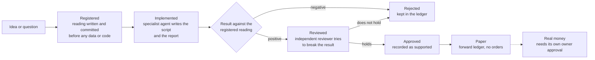
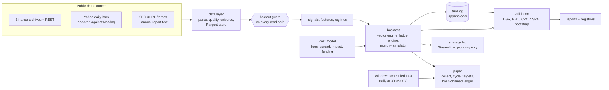
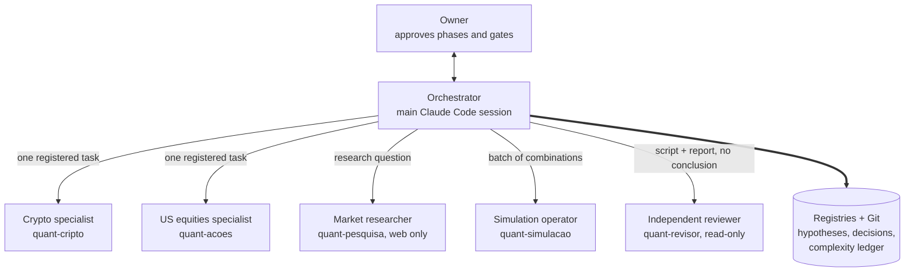

<h1 align="center">Quant Research</h1>

  <strong>A systematic research system for crypto and US equities, built so that results cannot fool their author.</strong>

  For one investor who wants every trading idea tested like a scientific claim before any money follows it.

---

## What it is

A private Python research system (internal name `quant-tf`) that turns trading ideas into numbered, pre-registered hypotheses and tests them on point-in-time data. It covers crypto (spot and perpetuals, exchange data) and US equities (funds, index members, and small and mid-sized companies from SEC filings).

The work is done by a team of Claude Code agents: one orchestrator that talks to the owner and keeps the records, and five specialists that each run one registered task and hand back a report. Nothing in the system can send an order.

## The problem

Backtests lie in predictable ways. The author picks the period after seeing the chart. The universe is today's survivors. A balance-sheet number is used before it was published. Twenty variants are tried and only the best one is reported. With an AI assistant writing the code, the risk is larger: the model has read market history and can leak it into design choices without anyone noticing.

The system was built around one question: how do you make a positive result expensive to fake, including by accident?

## How it works

1. **Register.** The hypothesis and its pass criterion go into the hypotheses file and are committed to Git before any data is fetched or any result exists. The criterion is never edited later; changes are new entries.
2. **Implement.** The orchestrator hands the hypothesis number and the allowed file names to the crypto or equities specialist. The specialist writes the script, runs it and returns a verdict by the registered reading.
3. **Count.** Every backtest run is appended automatically to a trial log, which feeds the multiple-testing corrections.
4. **Review.** A positive result goes to an independent reviewer agent before it can be recorded as supported. The reviewer gets the script and the report, not the orchestrator's conclusion.
5. **Record.** The orchestrator writes the result paragraph, a row in the complexity ledger and a numbered decision entry, then commits. Bad results are written down as bad.
6. **Paper.** Candidates run forward in a daily paper cycle on data that did not exist when they were designed. No exchange key exists in this phase.

## Architecture

- **`data`**: readers for exchange archives, fund and stock prices, SEC fundamentals and filing text, a point-in-time universe builder, quality checks and the holdout guard and seal.
- **`backtest` + `costs`**: two daily engines with independent accounting, a monthly simulator for equities, and a cost model with taker fees, a spread estimated from bars, square-root market impact, a participation cap and real funding settlements.
- **`validation`**: Probabilistic and Deflated Sharpe Ratio, Probability of Backtest Overfitting via CSCV, CPCV paths, Hansen SPA and StepM, stationary bootstrap, Holm adjustment. Formulas are pinned by unit tests against published test vectors.
- **`lab`**: a Streamlit tool for exploration. Every configuration is logged, and the protocol says nothing found there counts as evidence until it is registered as a hypothesis.
- **`paper`** and **`theses`**: the forward cycle (collector, target weights, append-only ledger) and a forward-only ledger of dated claims scored after their outcome exists.
- **Library claims are checked in the installed source.** The SPA implementation in `arch` ignores its studentize flag, so the project studentizes the inputs itself and a test asserts the p-values change with scale. The `bidask` spread estimator returns an absolute value by default, which inflates spreads; the project calls it signed and clips at zero.

### The agent team

- **One writer.** Only the orchestrator writes to the registries, commits or updates the owner's notes, so two agents never collide on a file or a hypothesis number.
- **Narrow tools per role.** The researcher has web tools and no shell. The reviewer can run code but cannot edit files. Specialists can create their assigned script and report, never commit, and must stop and ask if the registration is ambiguous.
- **No authority in subagents.** A request for a permission, a rule change or an access goes to the owner, not to the orchestrator.

## Engineering decisions

**1. Seal the holdout in code, not by discipline.** The holdout boundary was fixed on day one, before any data was downloaded. Every read path in the data layer goes through a guard. Opening it needs a flag at the call site, an environment value and a dedicated data root, all three, and every opening is appended to a committed audit log. The seal is a SHA-256 over the remote listing of the holdout files (key, size, etag, last modified), so it was sealed without downloading any content, and files were verified against it before the single read. Chose this over a convention because a convention breaks the first time a helper function loads "all the data". Cost: the guard is rigid (six tests fail on purpose when the variable is set), and it cannot seal what the people already know about recent markets. The decision log says so explicitly, which is why forward paper trading is treated as the only truly blind test.

**2. Count trials by machine, not by hand.** Every backtest run appends a row (config hash, commit, hypothesis id, observations, Sharpe, skew, kurtosis) to an append-only log, and the Deflated Sharpe Ratio reads the trial count and dispersion from that file. Chose this over a typed number because manual trial counts are always too low. Cost: the log never forgets. When a script was rerun with logging on, the duplicate rows stayed and were explained in a decision entry instead of being deleted.

**3. Two engines that must agree, plus causality tests.** A vectorized engine (weights times returns) and a ledger engine (units, cash, perpetual settlement, funding cash flows) are checked against each other with property-based tests on synthetic panels with gaps, delistings, perpetuals and costs: NAV must match to 1e-9 relative. Separate tests perturb all data after day t and assert that every output up to t is unchanged. Signals are decided at the close of t and filled at a time-weighted price on t+1, because in a 24/7 market the next open is the same instant as the close. Delisted assets are valued at their last close with no knowledge of the announcement. Cost: every new feature (funding, borrow, cash rate) is written twice.

**4. A reviewer that does not see the conclusion.** Positive results go to a separate agent with a fixed checklist: was the registration committed before the script ran, look-ahead, figures used before their filing date, survivorship, t to t+1 alignment, costs, unit errors, concentration in a few cases, byte-for-byte reproduction and a placebo that shuffles the signal within each date. Corrections are new decision entries; the original stays. In one review the reviewer showed that a universe described as survivorship-free still dropped companies that disappeared before filing their next annual report, and the earlier reading was corrected on the record. Cost: a deep review used about 200 thousand tokens and 34 tool runs (2026-10-05), so only positive results get one.

**5. A paper ledger that cannot be quietly rewritten.** Each decision day writes one row per paper book to an append-only JSONL file where each row carries the SHA-256 of the previous one. The writer refuses duplicates, backfilled days (a missed day stays missed) and days whose close has not happened; the file is committed after every write, which covers the tail truncation a hash chain cannot see. Data comes from public endpoints only: no account, no key, no order code path. A rehearsal week before the first counted day caught a real bug: at 00:05 UTC the fund bar of the day had an empty close, which became a NaN that slipped past a null filter. The fix stores a provisional regular-session price, replaces it once with the final bar and logs the change. Cost: the cycle runs on the owner's PC, so a machine that is off means late or missed days, which count against an operations criterion.

## Results

Process facts only. Rules, parameters, assets and performance are not published.

- **Build window:** first commit 2026-10-02; 181 commits through 2026-10-26.
- **Hypotheses:** 55 registered (H-001 to H-056, one number unused), each committed before its first result.
- **Decisions:** 76 numbered entries (D-001 to D-076) by 2026-10-26, including audit notes on the project's own slips.
- **Trials:** 227 backtest runs in the machine trial log, 2026-10-03 to 2026-10-26.
- **Complexity ledger:** 60 entries by 2026-10-26; 46 of them end as rejected, failed or not adopted, and all stay in the file.
- **Holdout:** boundary fixed 2026-10-02, opened once on 2026-10-03 under a protocol registered before the read.
- **Tests:** 220 passing on 2026-10-06 (unit, property-based, look-ahead, holdout guard, repository hygiene).
- **SEC text data:** 49,862 annual reports of 4,971 companies downloaded for the text tests (2026-10-05).
- **Paper period:** rehearsal 2026-10-06 to 2026-10-11; 16 counted weeks from 2026-10-12 to 2027-01-31 (112 days). The ledger has been committed every day since 2026-10-12.
- **Forward cohorts:** score files committed before their start dates in 2026-10, to be scored on 2027-04-06 and 2027-10-06.

## Stack

- **Language and tooling:** Python 3.14, uv, ruff
- **Data:** Polars, PyArrow (Parquet store), pandas, httpx
- **Numerics and models:** NumPy, Numba, SciPy, statsmodels, arch, scikit-learn, LightGBM, hmmlearn, cvxpy
- **Tests:** pytest, Hypothesis (property-based)
- **Lab and charts:** Streamlit, Plotly, Matplotlib
- **Text models:** a local language model through Ollama, used only on dates after its training cutoff
- **Operations:** Windows Task Scheduler, Git as the audit trail
- **Agents:** Claude Code orchestrator and five custom subagents

## My role

Solo project; every commit in the repository is mine. I set the research method and its rules (register before running, no hindsight, every trial counted, no real order without my approval per phase), approved or closed each phase gate, decided the scope and length of the paper period, and designed the agent team: the roles, the tool limits of each agent, the single-writer rule and the blind review. Claude Code agents wrote and ran most of the code under that process; the decisions, the gates and the final reading of each result were mine.

---

> Source code is private. This repository is a case study.

<a href="https://github.com/AllanHert">github.com/AllanHert</a>

